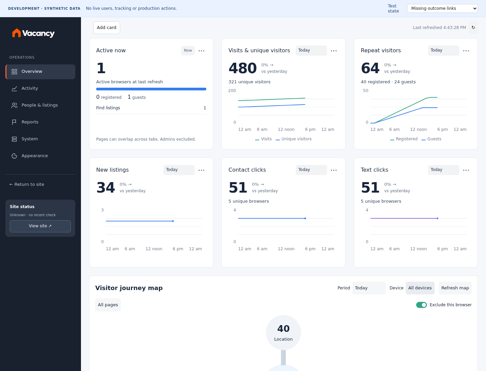
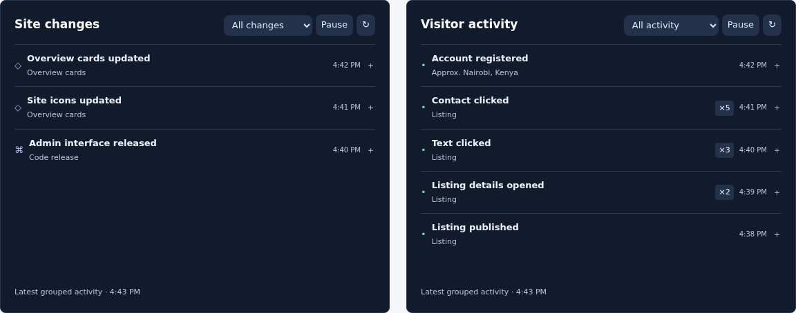

# Complete cards and feeds — pre-publication review

Status: PASS locally; production activation and authenticated hosted acceptance UNVERIFIED. No production schema/data writes or deployments were performed in this task. Metadata-only production reads confirmed the missing optional tracking and appearance RPCs; the new slice does not call those absent endpoints.

## Mockup comparison

Images below show the actual curated application with explicitly synthetic data, not live visitors.





| Approved requirement | Implementation | Evidence |
| --- | --- | --- |
| Six-card fresh layout | Active now, visits/unique, repeat visitors, new listings, contact clicks, text clicks | Curated production composition and screenshot |
| Readable shared hierarchy | 16px headings, 42px totals, adjacent comparisons, compact header periods, full-width 140px plots and bottom legends | Visual inspection; overflow checks at desktop widths |
| Balanced full rows | Existing six-column shell retained; inner card rows rebalance with readable minimum width | Browser resize checks |
| Active registered/guest split | Distinct browsers, registered precedence across tabs, unknown identity retained separately; expiring presence source | Disposable SQL deduplication/expiry checks |
| Contact/Text totals and unique browsers | Separate named events; server aggregates; equal elapsed comparisons only when coverage exists | Browser queue + SQL counts/deduplication tests |
| Continuous truthful graphs | Known zero buckets are zero; pre-activation history stays unknown and is omitted, not fabricated | SQL coverage tests; comparison-unavailable browser case |
| Site-wide published UI/code activity | Installed favicon/icon configuration edits, published appearance-current edits if installed, and verified deployment receipts with affected sections | SQL trigger and release-ledger tests |
| Visitor engagement | Contact/Text, connected creation steps, first recorded publication transitions, confirmed registrations | SQL feed and fixture/browser checks |
| Approximate registration location | Nearest context within 15 minutes of confirmation; explicit approximate label; unavailable when absent | SQL join and browser cases |
| Compact dark feeds | Equal-width panels directly below the map, minute-level repetition grouping, filters, pause/resume, bounded scrolling | Browser/visual checks |
| Low impact and ghost admin | About 4.6KB public collector, shared bounded queue, one coarse-context read per 30-minute session/actor refresh, DNT/GPC/opt-outs respected, no entered text/IP/coordinates | Trusted-click and excluded-browser checks |

Saved existing layouts are preserved; missing Contact/Text metrics are added once and can be removed/reordered. Fresh installations use the approved six-card order. The feeds represent published UI configuration and deployed code, not unsaved editor changes. Future editors using a new storage table must register their published change source.

## Exact database candidate and preservation

Apply only `supabase/migrations/20261021162009_admin_engagement_and_activity_feeds.sql`, after specific production approval. Do not replay historical migrations.

- Adds three private RLS-protected tables: coverage settings, named engagement events and the published site-change ledger. No public direct table grants.
- Adds bounded recording/aggregate/feed functions and installed UI configuration triggers. Anonymous clients may record only allowlisted engagement fields; admin reports require existing active-admin/AAL2 verification. Release receipts are service-role-only.
- Replaces only the existing presence reporting function to add identity totals while preserving existing fields. Its exact previous live definition is saved in `ADMIN_COMPLETE_PRESENCE_ROLLBACK_20261022.sql`.
- Reads verified registrations from existing Auth records; does not alter Auth, roles, users, mail or account flows. Approximate city/country is untrusted analytics context, not verified location or authorization evidence.
- Visitor collection starts disabled. Only the first verified deployment receipt activates coverage. Pre-activation requests cannot manufacture a history of zeros. Existing events are never backfilled with fabricated interactions or locations.
- Reporting uses a 90-day window. A private bounded cleanup routine is provided but no scheduler is installed: production currently has no pg_cron/pg_net. Physical cleanup is a separately operated maintenance action, not a product-page side effect or an implicitly enabled schedule.

## Publication sequence after approval

1. Recheck live alias/source, migration prerequisites and preservation snapshot; apply only the scoped SQL candidate transactionally with the supplied timeouts. No historical replay.
2. Verify installed schema/privileges read-only. No synthetic customers, sign-ups, listings, contacts or messages on the live site.
3. Build `scripts/build-admin-production-candidate.mjs`, verify the actual composition and visual images, publish the curated artifact and verify asset hashes/native sign-in before alias change. Preserve `dpl_BUTFDuWyh36viYBR5kniLn3Fog3v` as rollback.
4. Verify the live alias, then run `scripts/admin-release-receipt.mjs --previous PREVIOUS_MANIFEST --manifest PATH --deployment dpl_ID --url https://getvacancy.site --summary TEXT`. It verifies served assets and generates the exact bounded receipt SQL; it does not load credentials or execute SQL. Execute that receipt through the authorized deployment connection to activate coverage and record the actual release/affected UI sections.
5. Record the deployment and activation receipt. Owner-authenticated observation of genuine new activity is still required for real-browser acceptance.

Rollback: return the alias to the preserved deployment. If needed, restore the saved presence function. Revoke execution of the new public recording function to stop cached new collectors. Preserve all engagement/site-change history; do not drop tables or delete customer data. UI-capture triggers are scoped to the named trigger `vacancy_site_change_feed` and can be disabled independently if required.

## Validation

- PASS: full isolated workspace suite — 82 browser passes, 22 intended skips, renderer and HTTP isolation checks.
- PASS: focused final feed checks, curated production composition and visual inspection.
- PASS: disposable PGlite 0.5.11 SQL checks for recording, idempotency, totals/distinct browsers, unknown coverage, registrations/location, grouping, filters, UI mutation/no-op behavior, release permissions, AAL1/non-admin rejection, identity deduplication/expiry and bounded cleanup.
- PASS: coarse-context endpoint rejects unsupported methods, sanitizes malformed headers and returns no IP or coordinates.
- UNVERIFIED: real production activation, owner-authenticated live counts and journeys. No publication until database approval and all required checks pass.

Reproduce SQL checks without hosted access:

```sh
npm install --prefix /tmp/vacancy-complete-sql --ignore-scripts --no-audit --no-fund @electric-sql/pglite@0.5.11
node tests/admin-complete-sql.check.mjs
node tests/visitor-context.check.cjs
```
